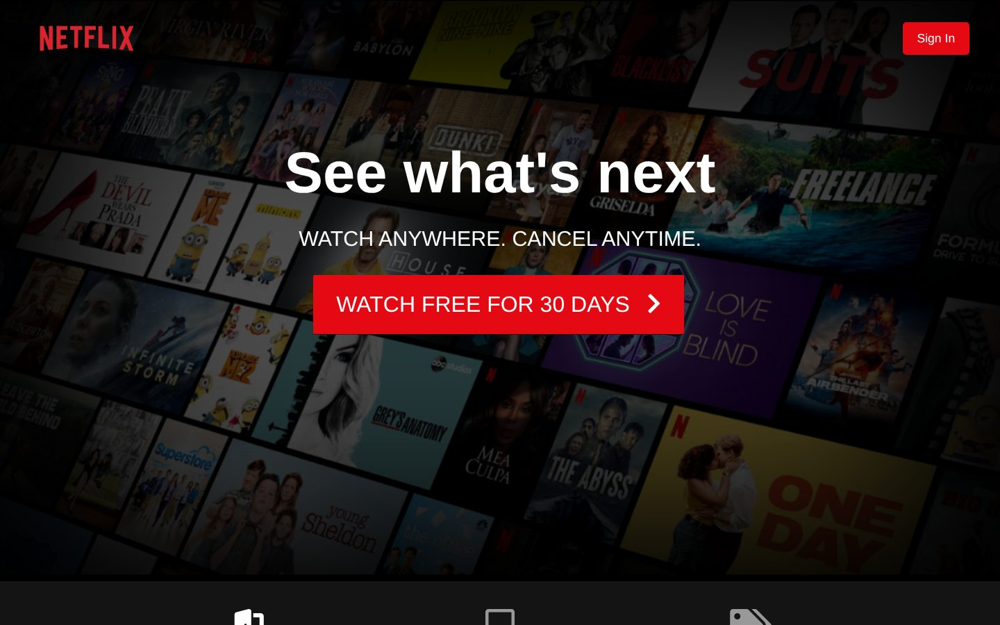
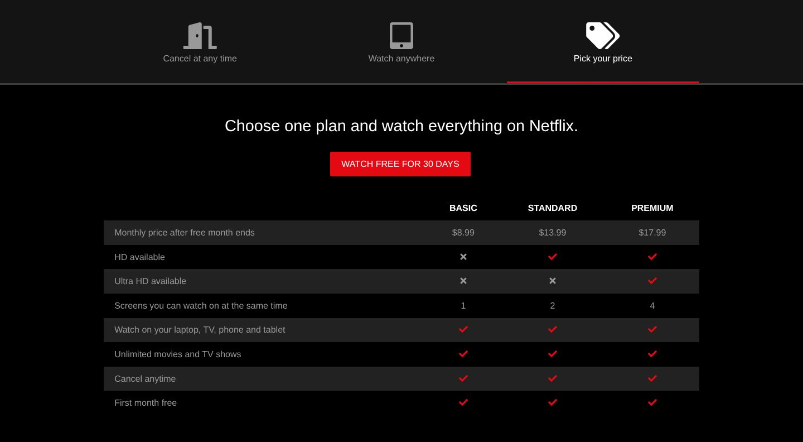

# Netflix Mockup

A responsive clone of the Netflix landing page, built with plain **HTML5, CSS3 and vanilla JavaScript** as one of my foundational frontend projects during my SIWES internship at Cavista Technologies.

**Live demo:** https://tolu-15.github.io/netflix-mockup/



## Features

- Full-screen hero section with background image, dark overlay and call-to-action
- Interactive tab section ("Cancel at any time", "Watch anywhere", "Pick your price") switched with JavaScript, with keyboard and ARIA support
- Device showcase grid built with CSS Grid
- Responsive pricing comparison table
- Mobile-first breakpoints at 1024px, 768px and 500px
- Font Awesome icons



## Project structure

```
netflix-mockup/
├── index.html            # Page markup
├── css/
│   └── style.css         # All styles (variables, layout, components, media queries)
├── js/
│   └── main.js           # Tab switching logic
├── assets/
│   └── images/           # Logo, hero background and device images
└── docs/                 # README screenshots
```

## Run locally

No build step needed. Clone the repo and open `index.html` in a browser:

```bash
git clone https://github.com/Tolu-15/netflix-mockup.git
cd netflix-mockup
# open index.html, or serve it:
npx serve .
```

## Built with

HTML5 · CSS3 (Flexbox, Grid, custom properties) · JavaScript (ES6) · Font Awesome 5

## Disclaimer

This is an educational UI clone for learning purposes only. It is not affiliated with or endorsed by Netflix, Inc. All trademarks and images belong to their respective owners.
